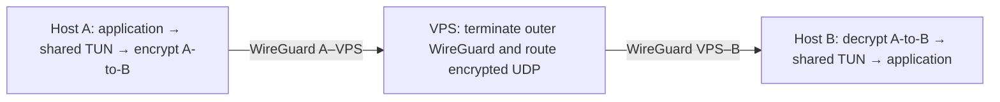
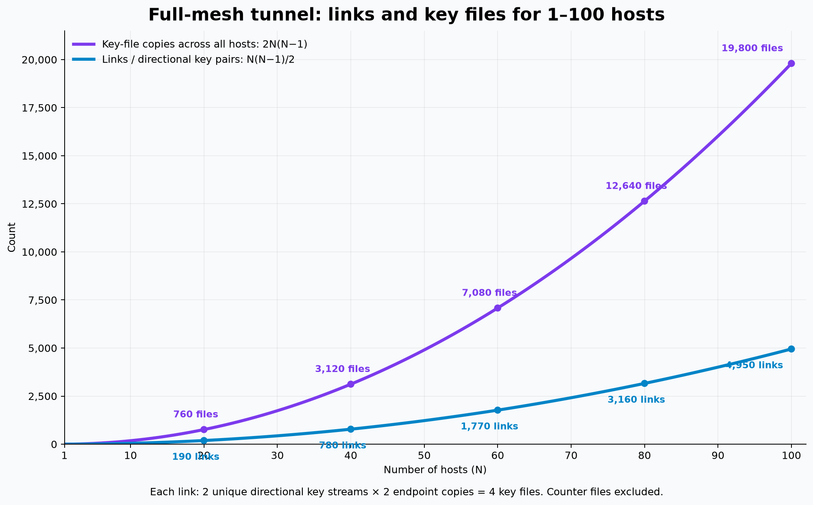
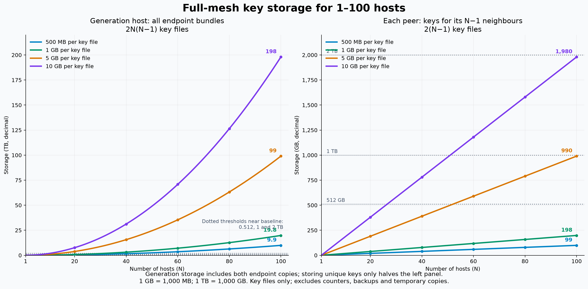
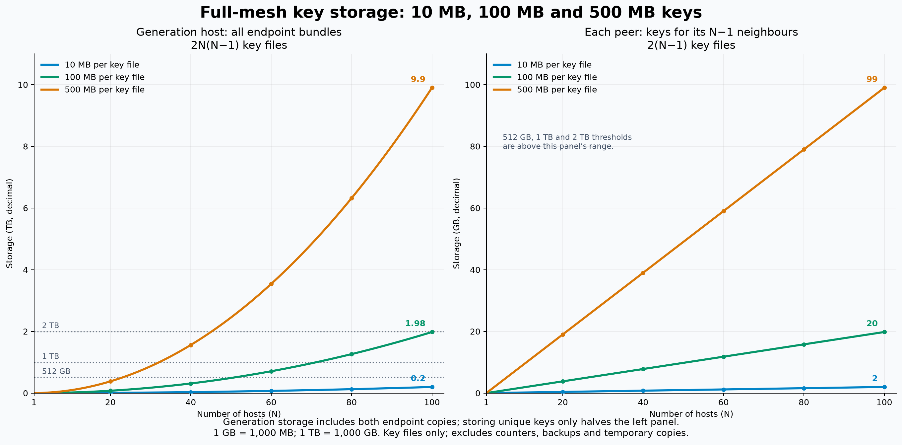
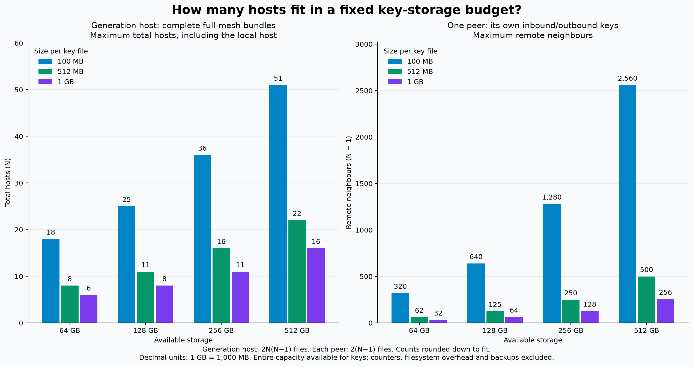

# Future design: multi-peer encrypted overlay

Status: design proposal, 2026-10-29. This document records the architecture and
sizing discussion; none of the multi-peer features described here are implemented.

## Objective

Connect 32 endpoint hosts through a WireGuard VPS while keeping their inner
traffic encrypted end-to-end. Each endpoint has one shared TUN interface and
independent directional key material for every other endpoint. The VPS routes
encrypted UDP packets and never receives the inner tunnel's key material.

Throughout this document, **N means total endpoint hosts**, excluding a relay-only
VPS. A network of 32 hosts gives each host 31 remote peers. A host with 32 remote
peers belongs to a network of 33 hosts.

## Current implementation

- `client.c` sends all TUN packets to one configured IPv4 endpoint.
- `server.c` pins the first authenticated peer until restart.
- Each process has one inbound key, outbound key, and corresponding counters.
- `tun.c` hardcodes `tun0`; the setup scripts hardcode a two-host address plan.
- `socket.c` uses a ten-byte wire header (key offset and payload length),
  ciphertext, and a 32-byte HMAC. There is no peer identifier in the header.
- The receiver accepts only traffic packets. There is no implemented discovery,
  hello, keepalive, route exchange, or authenticated endpoint migration protocol.
- Packets behind the accepted key offset are dropped, including reordered ones.

Removing server peer pinning would not create multi-peer support. The program
must first select the correct independent key state and outgoing destination.

## Proposed topology

Use a logical full mesh of inner encrypted associations over a WireGuard
hub-and-spoke transport. The inner associations terminate only on endpoint hosts.

| Layer | VPS | Host A | Host B |
| --- | --- | --- | --- |
| WireGuard transport | `10.0.0.1` | `10.0.0.2` | `10.0.0.3` |
| Private TUN overlay | None required | `10.50.0.1` | `10.50.0.2` |

For 32 hosts, transport addresses could run from `10.0.0.2` to `10.0.0.33`,
and overlay addresses from `10.50.0.1` to `10.50.0.32`. These are example ranges;
deployment must avoid collisions with existing networks.

The VPS necessarily has its own WireGuard private/session keys. It must have
**no inner peer-to-peer key files**. WireGuard alone does not hide packets from
a hub that terminates its connections: the inner encryption supplies that
boundary. See the [WireGuard architecture](https://www.wireguard.com/papers/wireguard.pdf).

For an A-to-B packet:

1. Linux routes the destination overlay address into A's `tun0`.
2. A's daemon maps the destination to B and encrypts using A-to-B material.
3. It sends the encrypted UDP datagram to B's transport address, `10.0.0.3`.
4. WireGuard carries it to the VPS. The VPS removes the outer encryption and
   forwards the still-encrypted inner datagram toward B through WireGuard.
5. B authenticates and decrypts it, validates its inner source address, and
   writes the IP packet into B's `tun0`.

The VPS does not run a decrypting instance of this inner tunnel. Relaying consumes
no additional inner keys: A encrypts once and B decrypts once.

## Shared TUN and peer selection

Each endpoint has one `wg0`, one `tun0`, and a table of independent peer records.
For example, A could have:

| Overlay destination | UDP transport endpoint | Cryptographic state |
| --- | --- | --- |
| `10.50.0.2/32` | `10.0.0.3:9000` | A–B directional keys and counters |
| `10.50.0.3/32` | `10.0.0.4:9000` | A–C directional keys and counters |

Linux selects the overlay interface; the daemon selects the peer. Each peer
record needs its permitted inner source prefixes, endpoint, keys, counters, and
operational status. Initially, static host `/32` mappings avoid ambiguous prefix
selection. Subnet routes would require a defined longest-prefix policy.

Incoming UDP must be mapped to a candidate peer before authentication. For fixed
WireGuard addresses, a configured source-address/port mapping can do this; source
addresses are lookup hints, not proof of identity. Authentication with that
peer's inner key remains mandatory, even if the packet arrived through WireGuard.
After decryption, reject inner source addresses not authorized for that peer.

One UDP socket per peer is another initial option and does not require multiple
TUN interfaces. A future shared-port protocol with roaming or key rotation may
benefit from an authenticated link/key identifier. This would require explicit
wire-format design; trying every key for every packet is not the intended model.

Client/server becomes a per-link initiation behaviour rather than a host-wide
role. Static reachable transport endpoints can send in either direction. Dynamic
endpoint updates, discovery, and liveness messages remain separate future work.

## Routing requirements

- Endpoints route overlay destinations into `tun0` and transport destinations
  through WireGuard. The public VPS endpoint must remain reachable outside the
  overlay to avoid recursive tunnelling.
- On the VPS, each WireGuard endpoint has its own transport `/32` in `AllowedIPs`.
  On endpoints, the VPS WireGuard peer must allow the transport destinations and
  source addresses of the other endpoints, not only `10.0.0.1`.
- The VPS enables IP forwarding and permits the inner UDP transport between
  endpoints. Preserve transport source addresses; NAT is unnecessary for this
  internal routing model.
- Keep application traffic on the inner overlay. Sending it directly to transport
  addresses would bypass the inner encryption.
- Choose and validate an MTU for both encapsulation layers. Do not assume the
  current 1400-byte setting fits every deployment.

TUN exchanges IP packets with the kernel; this is a routed overlay, not a shared
Ethernet segment. Broadcast discovery and layer-2 bridging are outside this design.
See the [Linux TUN documentation](https://kernel.org/doc/html/latest/networking/tuntap.html)
and [IP forwarding documentation](https://docs.kernel.org/networking/ip-sysctl.html).

## Alternative interface and topology designs

| Design | Interfaces per host | Trade-off |
| --- | --- | --- |
| One TUN per neighbour | N−1 | Smallest extension of the existing packet path; Linux sees every link and handles routing |
| One shared TUN | 1 | Cleaner for a static full mesh; daemon must select peers and enforce prefix policies |
| Several shared TUNs | Configurable | Useful for separate routing/trust groups; unnecessary for equivalent hosts |

One TUN per link remains a good basis for an arbitrary routed partial mesh with
transit hosts and eventual dynamic routing. When a transit host decrypts and
re-encrypts on separate links, it sees plaintext and consumes key material on
each hop. That is distinct from the proposed VPS forwarding opaque end-to-end UDP.

A star of inner encrypted links uses only N−1 key pairs but lets the hub decrypt
spoke-to-spoke traffic. It does not meet the VPS confidentiality requirement.
The proposed physical star retains all full-mesh inner key associations.

## Keys and storage formulas

Every unordered host pair needs two independent directional key streams. The
A-to-B stream is stored as A's outbound file and B's inbound file. No material
may be reused across links or directions. Matching endpoint copies are intentional.

For N total hosts and size S per key file:

| Quantity | Formula |
| --- | --- |
| Links / directional key pairs | N(N−1)/2 |
| Unique directional key streams | N(N−1) |
| Key-file copies across all endpoint bundles | 2N(N−1) |
| Key files on each endpoint | 2(N−1) |
| Generator storage holding all endpoint bundles | 2N(N−1)S |
| Generator storage holding one copy of each unique stream | N(N−1)S |
| Storage on each endpoint | 2(N−1)S |

For **32 total hosts**: 496 links, 992 unique streams, 1,984 endpoint file copies,
and 62 key files per host. At 1 GB per file, that is 62 GB per host and 1.984 TB
for a generator retaining all bundles. A relay-only VPS stores none of these files.

A peer with exactly 64 GB available for 1 GB key files can store keys for 32
remote neighbours (33 total hosts). This is a key-only capacity calculation,
not a recommendation to fill a nominal 64 GB disk completely.

Generate and provision inner keys through a trusted process outside the VPS.
A generator that sees all keys is itself trusted; distributing generation among
host pairs is possible but requires a separately designed provisioning process.
Securely delivering keys cannot rely solely on transport terminated by the VPS.

All graphs use decimal units: 1 GB = 1,000 MB and 1 TB = 1,000 GB. They exclude
counter files, filesystem overhead, temporary copies, and backups. Generator
figures assume all endpoint bundles coexist; keeping unique streams only halves
those figures. Streaming generation/distribution may reduce peak storage but is
not represented by the graphs.

## Graphs

### Full-mesh link and file counts

[SVG](full-mesh.svg) · [CSV](full-mesh.csv). Counts are labelled every 20 hosts.

### Storage with 500 MB, 1 GB, 5 GB, and 10 GB keys

[SVG](key-storage.svg) · [CSV](key-storage.csv). Dotted reference lines show
512 GB, 1 TB, and 2 TB; they are close to the baseline on the generator panel.

### Storage with 10 MB, 100 MB, and 500 MB keys

[SVG](key-storage-small.svg) · [CSV](key-storage-small.csv). Reference lines appear
on the generator panel; all exceed the per-peer panel's range.

### Hosts fitting fixed storage budgets

[SVG](storage-fit.svg) · [CSV](storage-fit.csv).

For budget C, the generator's maximum total host count is the largest integer N
such that `2N(N−1)S ≤ C`. An endpoint's maximum remote-neighbour count is
`floor(C / (2S))`; add one for total hosts. These are different quantities and are
labelled separately on the graph.

| Generator budget | Total hosts, 100 MB keys | Total hosts, 512 MB keys | Total hosts, 1 GB keys |
| --- | ---: | ---: | ---: |
| 64 GB | 18 | 8 | 6 |
| 128 GB | 25 | 11 | 8 |
| 256 GB | 36 | 16 | 11 |
| 512 GB | 51 | 22 | 16 |

| Endpoint budget | Remote neighbours, 100 MB keys | Remote neighbours, 512 MB keys | Remote neighbours, 1 GB keys |
| --- | ---: | ---: | ---: |
| 64 GB | 320 | 62 | 32 |
| 128 GB | 640 | 125 | 64 |
| 256 GB | 1,280 | 250 | 128 |
| 512 GB | 2,560 | 500 | 256 |

## Security and operational limits

The VPS sees transport identities, timing, sizes, traffic volumes, and the current
inner protocol's cleartext offsets and lengths. It cannot decrypt inner packets
without their keys, assuming the inner construction and implementation hold.
It can record, drop, delay, reorder, or redirect traffic. Inner authentication
must remain the authority for acceptance. This proposal is not a cryptographic
audit or a claim that the VPS cannot disrupt service.

The current transport consumes `L + 34` key bytes for an inner IP packet of L
bytes: two traffic-header bytes and 32 separate authentication bytes. Files are
consumable material, not indefinitely reusable session secrets. Capacity planning
must include traffic volume, exhaustion reporting, and secure replenishment.

Counter persistence, key erasure, crash recovery, and exclusive ownership must
remain independent per link/direction. Never reset counters for existing keys.
Existing native-C-long counters also have portability limitations.

The current receiver drops reordered packets behind its accepted offset. A future
replay window must account for variable consumed key ranges and erasure, not just
add a sequence-number bitmap. Every packet currently performs synchronous file
operations; a shared daemon could stall all peers on one slow storage operation.
Measure this before deciding scheduling or concurrency details.

## Proposed implementation stages

1. Define a common node configuration with explicit interface/address settings
   and independent peer records. Preserve current key-consumption invariants.
2. Implement shared-TUN destination lookup, inbound peer selection, and strict
   authenticated source-prefix validation for static full-mesh hosts.
3. Validate two endpoints through a WireGuard relay, then expand to 32. Verify
   relay captures contain only inner ciphertext and no inner keys are provisioned
   there. Test wrong-peer packets, replay, routing, and MTU limits.
4. Add operational visibility for peer state, key remaining, failures, and
   exhaustion. Measure storage latency and aggregate VPS bandwidth requirements.
5. Design authenticated startup/liveness, rotation, endpoint changes, and any
   replay-window improvement explicitly before adding them. Discovery and dynamic
   routing are optional later features, not prerequisites for the static design.

No deployment, network changes, or tunnel implementation are performed by this
document. End-to-end integration and failure testing remain future work.
